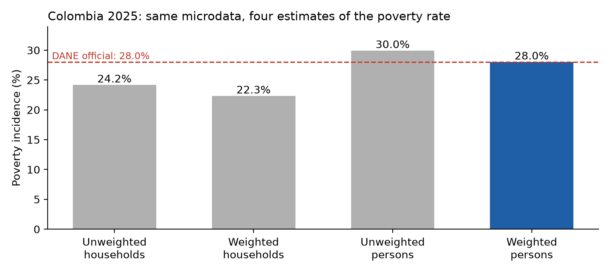

# Replicating Colombia's official monetary poverty rate from GEIH microdata

> **Status: work in progress.** The 2025 national, urban and rural poverty, extreme poverty and
> Gini figures are replicated from the microdata (table below). Breakdowns by department and sex of
> household head, a second year, and design-based standard errors are next.

## Question

Can DANE's official 2025 monetary poverty, extreme poverty and Gini figures be reproduced
from the public microdata, and what do the same data show beyond the published tables?

## Data

DANE, *Medición de Pobreza Monetaria y Desigualdad* (built on the Gran Encuesta Integrada
de Hogares, GEIH), microdata portal: [2025](https://microdatos.dane.gov.co/index.php/catalog/908),
[2024](https://microdatos.dane.gov.co/index.php/catalog/874). Two files: `hogares`
(one row per household) and `personas` (one row per person). Key variables:

| Variable | Meaning |
|---|---|
| `ingpcug` | per-capita income of the spending unit (*unidad de gasto*) |
| `lp`, `li` | poverty line and extreme poverty line (per capita, monthly) |
| `pobre`, `indigente` | poor / extremely poor flags |
| `fex_c` | expansion factor (sampling weight) |
| `npersug` | persons in the spending unit |
| `fac_emp` | splice factor — empalme datasets only: use `ingpcug × fac_emp` |

Variable names change across releases; `src/povcol/load.py` maps known aliases and the
notebook prints the mapping so it can be checked against each year's data dictionary.
Raw files are not committed (`data/` is gitignored).

## Method

- **Weights.** The GEIH is a stratified, clustered sample, so households differ in how many
  people they represent. `fex_c` is the number of households each sampled household stands for.
  Poverty incidence is a share of *persons*, so each household is weighted by `fex_c × npersug`.
- **Why it matters.** Rural and poorer areas are sampled at different rates than cities; an
  unweighted mean over survey rows estimates the poverty rate *of the sample*, not of Colombia.
  The replication reports both to show the size of that error.
- **Own implementations.** Weighted quantiles and the Gini coefficient are written from scratch
  in `src/povcol/weighted.py` and unit-tested (equal-weight and replication-weight identities,
  pairwise mean-absolute-difference formula).

## Replication (DANE 2025 bulletin vs. this repo)

| Indicator (2025) | DANE | This repo | Difference |
|---|---|---|---|
| Monetary poverty, national (%) | 28.0 | 28.04 | +0.04 |
| Monetary poverty, cabeceras (%) | 24.6 | 24.65 | +0.05 |
| Monetary poverty, rural (%) | 39.5 | 39.51 | +0.01 |
| Extreme poverty, national (%) | 9.6 | 9.65 | +0.05 |
| Extreme poverty, cabeceras (%) | 6.9 | 6.86 | −0.04 |
| Extreme poverty, rural (%) | 19.1 | 19.07 | −0.03 |
| Gini, national | 0.531 | 0.530 | −0.001 |
| Gini, cabeceras | 0.507 | 0.506 | −0.001 |
| Gini, rural | 0.476 | 0.476 | 0.000 |

All poverty rates are within ±0.1 pp of the official figures. Gini is ~0.001 below DANE's.
Full table: [`results/replication_2025.csv`](results/replication_2025.csv); code: [`notebooks/02_replicate.ipynb`](notebooks/02_replicate.ipynb).
Source: DANE, [Boletín técnico, Pobreza monetaria en Colombia, año 2025](https://www.dane.gov.co/files/operaciones/PM/bol-PM-2025.pdf) (12 June 2026).

### Why the weights matter



Computed naively from the same file, the poverty rate ranges from 22.3% to 30.0%. Two separate
mistakes drive this: counting **households instead of persons** (poor households are larger) and
**ignoring the expansion factors**. The GEIH deliberately oversamples small capital cities
(Quibdó has 3.0% of the sample but 0.2% of the population) and undersamples rural areas
(13.5% of sampled households vs. 22.8% of the population). Only the person-level weighted
estimate (`fex_c × npersug`) reproduces the official 28.0%.


## Plan

- [x] Repo, download script, data loading and sanity checks (`notebooks/01_load_data.ipynb`)
- [x] Weighted quantile and Gini functions with tests (`src/povcol/weighted.py`)
- [x] Replicate national poverty, extreme poverty and Gini; weighted vs. unweighted comparison (`notebooks/02_replicate.ipynb`)
- [ ] Breakdowns: urban/rural, department, sex of household head; weighted Gini
- [ ] Second year (2024 vs 2025) and design-based confidence intervals (`samplics`)
- [ ] Charts and limitations

## Reproduce

```bash
pip install -r requirements.txt
python data/download.py 2025 --zip ~/Downloads/<dane_file>.zip   # portal needs a free login
jupyter lab notebooks/01_load_data.ipynb
pytest tests
```

## Repository layout

```
data/download.py        fetch + unpack microdata into data/raw/<year>/ (gitignored), writes SHA-256 manifest
notebooks/              analysis notebooks (_build_nb.py regenerates 01 from source)
src/povcol/load.py      file discovery, variable-name mapping, splice factor, household-head sex
src/povcol/weighted.py  weighted mean/rate, weighted quantile, Gini
src/povcol/official.py  DANE published figures used as replication targets
tests/                  unit tests for the weighted statistics
```

## Limitations (to expand)

- Rates computed with expansion factors alone are point estimates; standard errors need the
  design variables (strata, PSUs), which may be restricted in the public files.
- DANE's income aggregate includes imputation and matching with administrative records
  (institutional transfers, PILA); the replication uses DANE's final `ingpcug` and does not
  rebuild income from the raw GEIH modules.
