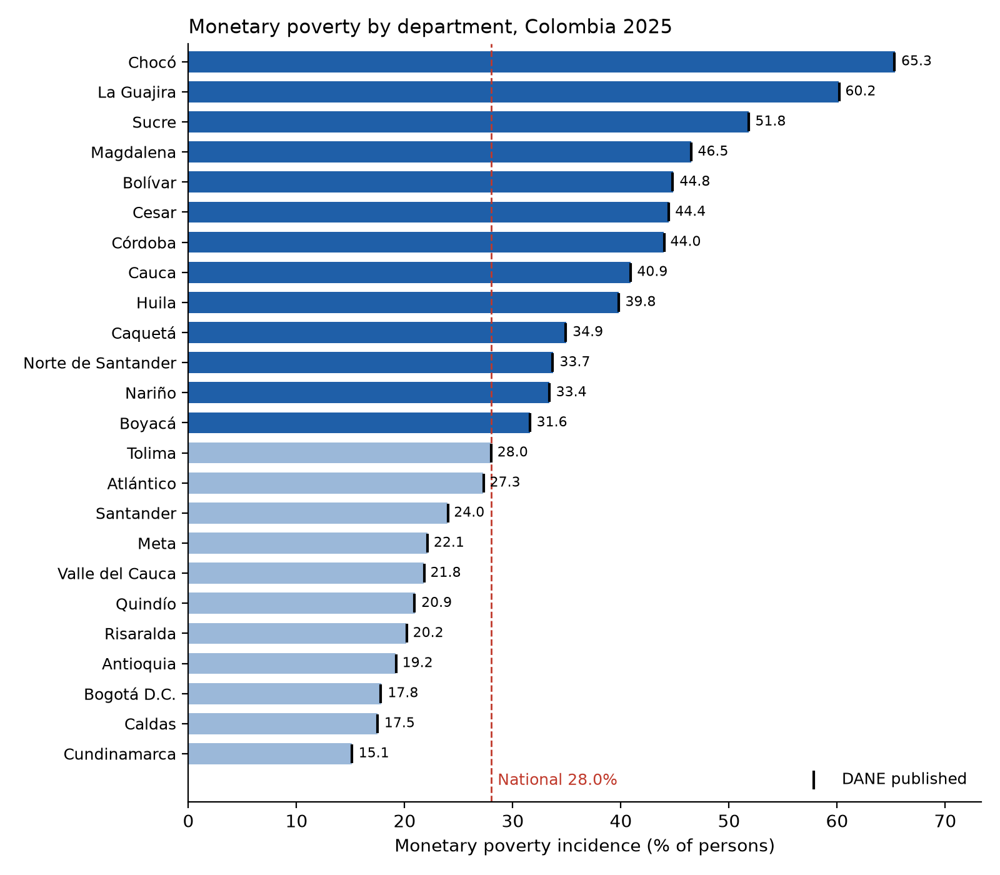
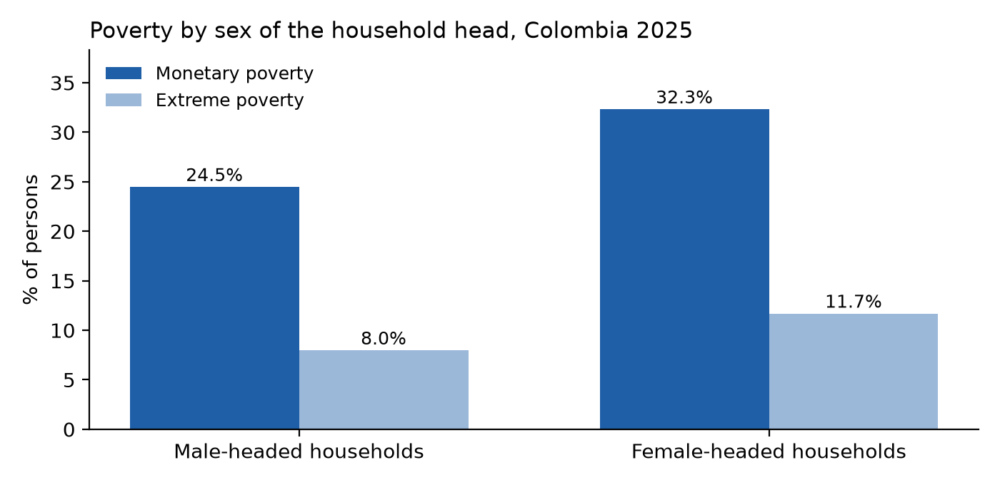
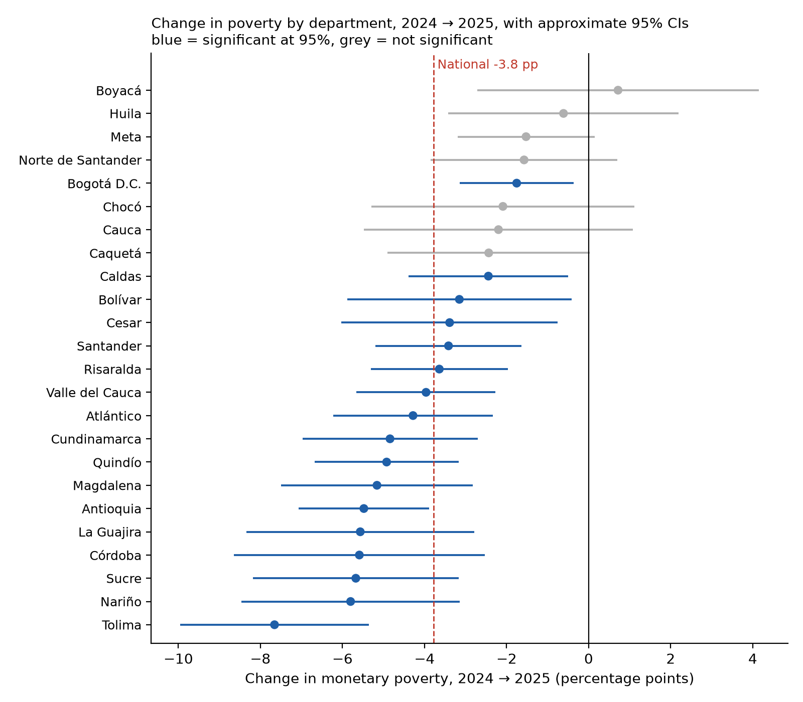

# Replicating Colombia's official poverty rate from GEIH microdata

Starting from DANE's household survey microdata, this project recomputes Colombia's official
monetary poverty, extreme poverty and Gini figures for 2024 and 2025 using the survey's
expansion factors, checks every number against DANE's publications, and then goes past the
published tables.

**Headline:** 73 of the 74 published DANE figures checked here round exactly to the replicated
values, including all 18 national, urban and rural figures (poverty, extreme poverty and Gini
for both years). The same file gives anywhere from 22% to 30% poverty if the weights or the
unit of analysis are handled wrongly. Poverty fell from 31.8% to 28.0% between 2024 and 2025,
a statistically significant decline of 3.8 points.

## Question

1. Can DANE's official poverty and inequality figures be reproduced from the public microdata?
2. Why do survey weights matter, and how much?
3. What do the data show by department and by sex of the household head, how did poverty change
   between 2024 and 2025, and how precise are these estimates?

## Data

DANE, *Medición de Pobreza Monetaria y Desigualdad*, built on the Gran Encuesta Integrada de
Hogares (GEIH): [2025](https://microdatos.dane.gov.co/index.php/catalog/908) (276,666 households,
773,932 persons) and [2024](https://microdatos.dane.gov.co/index.php/catalog/874) (275,057
households, 784,910 persons). Two files per year: `hogares` (one row per household) and
`personas` (one row per person).

| Variable | Meaning |
|---|---|
| `ingpcug` | per-capita income of the spending unit (*unidad de gasto*) |
| `lp`, `li` | poverty and extreme poverty lines (per capita, monthly; 50 domain-specific values) |
| `pobre`, `indigente` | poor / extremely poor flags |
| `nper` | persons in the household |
| `npersug` | persons in the spending unit (household minus domestic workers, pensioners and their relatives) |
| `fex_c` | expansion factor (national, urban/rural estimates) |
| `fex_dpto` | departmental expansion factor (department estimates) |
| `p3271`, `p6050` | sex; relationship to household head (in `personas`) |

Raw files are not committed (`data/raw/` is gitignored); `data/download.py` unpacks them and
records SHA-256 checksums of every input. The loader harmonizes differences between releases
(2024 stores the department as a code and `clase` as text; 2025 uses names and numbers).

## Method

- **Unit of analysis.** Poverty incidence is a share of people, but `hogares` has one row per
  household. Each household row is weighted by `fex_c × nper`: every household member is
  assigned the spending unit's per-capita income. Weighting by spending-unit members
  (`npersug`) instead comes close but is not exact (28.05% poverty, 9.65% extreme poverty, Gini
  0.001–0.002 too low); `nper` reproduces every national figure and makes the household file's
  population equal the person file's exactly (51,590,081 in 2025).
- **Expansion factors.** The GEIH oversamples the 23 capital cities and undersamples rural
  areas by design; `fex_c` undoes this. Department figures use `fex_dpto`, which is calibrated
  to departmental population projections.
- **Merge.** Sex of the household head comes from `personas` (`p6050 == 1`) and is merged
  one-to-one onto `hogares` on `directorio` + `secuencia_p` (every household matched).
- **Own implementations.** Weighted rate, weighted quantile, Gini (Lorenz-curve form) and a
  linearized standard error for ratio estimators are written from scratch in
  `src/povcol/weighted.py` and unit-tested against textbook identities (`tests/`).
- **Uncertainty.** The public files have no stratum or cluster identifiers, so full
  design-based standard errors (e.g. `samplics`) are not possible. Confidence intervals use
  Taylor linearization with households as units and survey domains as strata. Ignoring
  clustering makes them too narrow, so they are validated against DANE's own significance calls.

## Results

### 1. Replication of the official figures

| Indicator | 2024 DANE | 2024 this repo | 2025 DANE | 2025 this repo |
|---|---|---|---|---|
| Monetary poverty, national (%) | 31.8 | 31.79 | 28.0 | 28.00 |
| Monetary poverty, urban (%) | 28.6 | 28.61 | 24.6 | 24.61 |
| Monetary poverty, rural (%) | 42.5 | 42.48 | 39.5 | 39.48 |
| Extreme poverty, national (%) | 11.7 | 11.69 | 9.6 | 9.64 |
| Extreme poverty, urban (%) | 8.7 | 8.68 | 6.9 | 6.85 |
| Extreme poverty, rural (%) | 21.8 | 21.84 | 19.1 | 19.06 |
| Gini, national | 0.551 | 0.551 | 0.531 | 0.531 |
| Gini, urban | 0.530 | 0.530 | 0.507 | 0.507 |
| Gini, rural | 0.482 | 0.482 | 0.476 | 0.476 |

All 18 figures round to DANE's published values, and the same code replicates both years
unchanged. Two independent routes give the same 2025 national rate: the `pobre` flag and the
count of poor persons `npobres` (both 28.003%).

Sources: DANE, [Boletín técnico Pobreza monetaria 2025](https://www.dane.gov.co/files/operaciones/PM/bol-PM-2025.pdf),
[departmental release](https://www.dane.gov.co/files/operaciones/PM/cp-PMDepartamental-2025.pdf),
[enfoque diferencial bulletin](https://www.dane.gov.co/files/operaciones/PM/bol-PMEnfoqueDiferencial-2025.pdf).
Code: [`02_replicate.ipynb`](notebooks/02_replicate.ipynb), [`04_two_years_and_uncertainty.ipynb`](notebooks/04_two_years_and_uncertainty.ipynb);
tables in [`results/`](results).

### 2. Why the weights matter


Computed naively from the same file, the 2025 poverty rate ranges from 22.3% to 29.9%. Two
separate mistakes drive this: counting **households instead of persons** (poor households are
larger) and **ignoring the expansion factors**. Quibdó has 3.0% of the sample but 0.2% of the
population; Bogotá has 3.5% of the sample but 15.6% of the population; rural areas are 13.5% of
sampled households but 22.8% of the population. Only the person-level weighted estimate
reproduces the official 28.0%.

### 3. Departments



With `fex_dpto`, all 24 departmental rates for 2025 round to DANE's (largest gap 0.04 pp); with
the national factor `fex_c`, La Guajira would be off by 3.5 pp. For 2024, 23 of 24 round to
DANE's value; Cundinamarca comes out at 19.98% against a published 20.1%. Poverty in 2025 ranges
from 15.1% (Cundinamarca) to 65.3% (Chocó), a factor of 4.3. Departments with higher inequality
also tend to be poorer (correlation between departmental Gini and poverty: 0.78; 0.71 without
Chocó).

### 4. Sex of the household head



32.3% of people in female-headed households are poor, against 24.5% in male-headed households,
DANE's exact figures (extreme poverty: 11.7% vs. 8.0%, also exact). The gap by the head's sex
(about 8 pp) is much larger than the gap between women and men as individuals (2.3 pp). Both
groups have the same average household size (2.8 persons), so the gap is not about household
size; it is descriptive, not causal.

### 5. Change 2024 → 2025 and precision

| Change 2024 → 2025 (pp) | Estimate | Approx. 95% CI |
|---|---|---|
| Monetary poverty, national | −3.8 | −4.3 to −3.3 |
| Monetary poverty, urban | −4.0 | −4.5 to −3.5 |
| Monetary poverty, rural | −3.0 | −4.1 to −1.9 |
| Extreme poverty, national | −2.1 | −2.4 to −1.7 |



Every national, urban and rural decline is statistically significant. Poverty fell
significantly in 17 of 24 departments (largest: Tolima, −7.7 pp); in Boyacá, Huila, Meta,
Norte de Santander, Caquetá, Cauca and Chocó the change cannot be distinguished from zero.
**These significance calls agree with DANE's in all 24 departments**, even though the intervals
ignore clustering. Level estimates are precise nationally (about ±0.3 pp) and less so by
department (±1.0 to 2.6 pp).

## Limitations

- **Standard errors are approximate.** No cluster or stratum identifiers in the public files;
  the intervals ignore clustering and understate uncertainty, though they agree with DANE's
  significance calls.
- **Income is taken as given.** DANE's per-capita income includes imputation and matching
  with administrative records (institutional transfers, social security contributions). The
  project uses DANE's final `ingpcug` and does not rebuild income from the raw GEIH modules.
- **One unexplained gap.** Cundinamarca 2024 (19.98% vs. 20.1%) is the only one of the 74
  checked figures that does not round to DANE's value.
- **Descriptive only.** Differences by department or sex of the head are not causal effects.

## Reproduce

```bash
conda create -n povcol python=3.11 && conda activate povcol
pip install -r requirements.txt
python data/download.py 2025 --zip <path-to-DANE-2025-zip>   # DANE portal needs a free login
python data/download.py 2024 --zip <path-to-DANE-2024-zip>
pytest tests
jupyter lab   # run notebooks/01 → 04 in order
```

## Repository layout

```
data/download.py        unpack DANE microdata into data/raw/<year>/ (gitignored), write checksums
notebooks/01_load_data.ipynb                   load files, map variable names, sanity checks
notebooks/02_replicate.ipynb                   2025 replication; weighted vs. unweighted
notebooks/03_breakdowns.ipynb                  departments, sex of household head, Gini, CIs
notebooks/04_two_years_and_uncertainty.ipynb   2024 replication, change 2024→2025, significance
notebooks/_build_*.py                          scripts that generate the notebooks from source
src/povcol/load.py      file discovery, variable-name and code harmonization, household-head sex
src/povcol/weighted.py  weighted rate, quantile, Gini, linearized ratio standard error
src/povcol/official.py  DANE published figures used as replication targets
results/                CSV outputs of every table
figures/                charts used in this README
tests/                  unit tests for the weighted statistics
```
